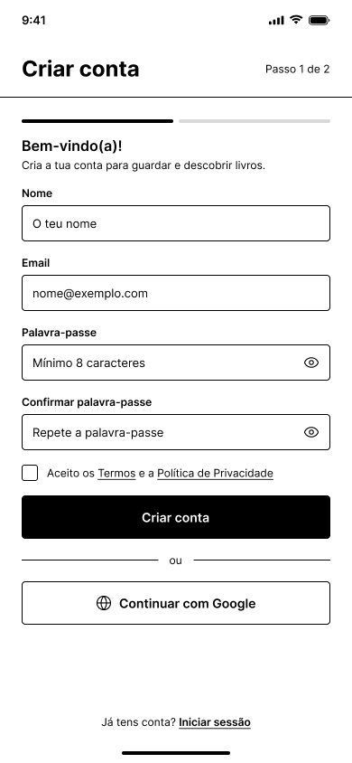

# Wireframes

Este documento liga cada ecrã às histórias de utilizador que ele cobre. Cada história aparece por extenso uma só vez, no ecrã principal onde acontece. Quando também toca noutros ecrãs, esses ecrãs remetem para ela.

## Índice

| Wireframe | Histórias principais | Também relacionadas |
|---|---|---|
| [Registo](#1-registo) | US-12 | US-13 |
| [Registo – Passo 2 (Gostos)](#2-registo--passo-2-gostos) | US-10, US-11 | US-08, US-16 |
| [Descobrir livros](#3-descobrir-livros) | US-01, US-02, US-03, US-04, US-05, US-16, US-17 | US-08 |
| [A minha estante](#4-a-minha-estante) | US-06, US-09 | US-18, US-19 |
| [Ações do livro](#5-ações-do-livro) | US-07, US-08, US-18, US-19 | — |
| [Perfil de leitor](#6-perfil-de-leitor) | US-14 | US-10, US-15 |
| [Sem wireframe](#7-histórias-sem-wireframe) | US-13, US-15 | — |

---

## 1. Registo

| ID | Épico | História | Critérios de aceitação |
|---|---|---|---|
| US-12 | Conta | Como visitante, quero criar uma conta com e-mail e palavra-passe para guardar os meus swipes e a minha estante. | O registo pede nome, e-mail e palavra-passe. Não é possível registar duas contas com o mesmo e-mail. A palavra-passe tem pelo menos 8 caracteres. Depois de criar a conta, avanço para o questionário de géneros (US-10). |

**Também relacionada:** US-13 (link "Iniciar sessão" no fundo do ecrã).

---

## 2. Registo – Passo 2 (Gostos)

.png)

| ID | Épico | História | Critérios de aceitação |
|---|---|---|---|
| US-10 | Recomendações | Como leitor novo, quero escolher os géneros de que gosto ao criar a conta para que o primeiro deck já tenha livros do meu interesse. | Depois de criar a conta, aparece a lista de géneros. Tenho de escolher pelo menos 3 géneros para continuar. Posso saltar este passo; nesse caso, o deck mostra livros populares. O primeiro deck mostra sobretudo livros dos géneros escolhidos. |
| US-11 | Recomendações | Como leitor novo, quero procurar livros que já li e marcá-los como lidos para que as recomendações partam dos meus gostos reais. | Há uma barra de pesquisa por título ou autor. Ao escolher um livro, aparece a janela de avaliação da US-08. O livro fica no separador Lidos e não aparece no deck. Posso terminar a qualquer momento e seguir para o deck. |

**Também relacionadas:** US-08 (janela de avaliação), US-16 (estes dados alimentam as recomendações).

---

## 3. Descobrir livros

| ID | Épico | História | Critérios de aceitação |
|---|---|---|---|
| US-01 | Swipe | Como leitor, quero ver as informações do livro (autor, sinopse, número de páginas) antes de fazer swipe para decidir se me interessa. | O cartão mostra capa, título, autor, sinopse e número de páginas. Se faltar algum destes dados, o cartão mostra os restantes sem espaços vazios. |
| US-02 | Swipe | Como leitor, quero fazer swipe para a direita num livro para o guardar na lista "para ler" e escolher a minha próxima leitura mais tarde. | O livro é adicionado à lista "para ler". O cartão sai do deck e o livro não volta a aparecer. A lista mantém-se depois de fechar e abrir a app. |
| US-03 | Swipe | Como leitor, quero fazer swipe para a esquerda num livro para indicar que não me interessa e deixar de o ver. | O cartão sai do deck. O livro não volta a aparecer no deck deste utilizador. O swipe fica registado como "não interessa". |
| US-04 | Swipe | Como leitor, quero fazer swipe para cima num livro que já li para o marcar como lido e, se quiser, dar-lhe uma nota. | O cartão sai do deck e o livro não volta a aparecer. Aparece a janela de avaliação da US-08 (0,5 a 5 estrelas, com meias estrelas e opção de saltar). |
| US-05 | Swipe | Como leitor, quero desfazer o último swipe para corrigir um engano. | O último livro volta ao topo do deck. O registo do swipe é removido e o efeito nas recomendações desaparece. Só o último swipe pode ser desfeito. Depois de desfazer, o botão fica desativado até haver novo swipe. |
| US-16 | Recomendações | Como leitor, quero que o deck me mostre livros parecidos com os que guardei e avaliei bem para descobrir leituras do meu gosto. | O deck nunca mostra livros que já avaliei. Depois de guardar vários livros de um género, a maioria dos cartões seguintes é desse género. Os livros que rejeito e as notas baixas fazem descer os géneros e autores desses livros. Sem swipes suficientes, o deck mostra livros dos géneros escolhidos na US-10 ou populares. |
| US-17 | Recomendações | Como leitor, quero ver livros populares quando acabam as minhas recomendações para continuar a descobrir livros. | Quando não há mais livros recomendados, aparece uma mensagem e a opção de ver os mais populares. Os populares são livros que ainda não avaliei, ordenados pelo número de vezes que foram guardados. Os swipes nos populares funcionam como no deck normal e contam para as recomendações. Se já avaliei todos os livros, aparece uma mensagem a dizer que não há mais livros, sem a opção dos populares. |

Correspondência entre botões e histórias: **Passar** → US-03, **Voltar** → US-05, **Já li** → US-04, **Quero ler** → US-02.

**Também relacionada:** US-08 (janela de avaliação depois de "Já li").

---

## 4. A minha estante

| ID | Épico | História | Critérios de aceitação |
|---|---|---|---|
| US-06 | Os meus livros | Como leitor, quero ver a minha estante com separadores (para ler, lidos, rejeitados) para encontrar rapidamente os meus livros. | Cada separador mostra capa, título e autor, do mais recente para o mais antigo. Posso abrir um livro para ver os seus detalhes. O separador Lidos mostra também a nota, quando existe. Cada separador vazio mostra uma mensagem a explicar como o preencher. |
| US-09 | Os meus livros | Como leitor, quero reconsiderar um livro rejeitado para o guardar na lista "para ler". | Posso mover um livro de Rejeitados para Para ler. O livro deixa de contar como rejeitado nas recomendações. |

**Também relacionadas:** US-18 (separador "A ler"), US-19 (reviews mostradas em Lidos).

---

## 5. Ações do livro

| ID | Épico | História | Critérios de aceitação |
|---|---|---|---|
| US-07 | Os meus livros | Como leitor, quero tirar um livro da lista "para ler" para manter a lista só com o que ainda quero ler. | Ao escolher remover, pergunto se já li o livro ou se deixei de querer lê-lo. Se escolher "deixei de querer lê-lo", o livro sai da lista e não volta ao deck. Se escolher "já li", avança para a US-08. |
| US-08 | Os meus livros | Como leitor, quero marcar um livro como lido e dar-lhe uma nota para registar o que achei. | Aparece uma janela com 0,5 a 5 estrelas, em passos de meia estrela, e a opção de saltar. A nota fica guardada e aparece no livro, no separador Lidos. Se saltar a avaliação, o livro fica marcado como lido, sem nota. |
| US-18 | Os meus livros | Como leitor, quero marcar um livro como "a ler" para acompanhar o que estou a ler agora. | Posso mover um livro de Para ler para A ler. O livro aparece no separador A ler, com a data em que comecei. Posso ter mais do que um livro a ler ao mesmo tempo. |
| US-19 | Os meus livros | Como leitor, quero terminar a leitura de um livro e escrever uma review para registar o que achei. | Ao escolher "terminei", o livro passa de A ler para Lidos. Aparece a janela de avaliação da US-08, com um campo de texto opcional para a review. A review fica guardada e aparece no livro, no separador Lidos. Só eu vejo as minhas reviews. |

Correspondência entre opções e histórias: **Mover para "A ler"** → US-18, **Marcar como "Lido"** e **Dar nota** → US-08, **Escrever review** → US-19, **Remover da estante** → US-07.

---

## 6. Perfil de leitor

| ID | Épico | História | Critérios de aceitação |
|---|---|---|---|
| US-14 | Conta | Como leitor, quero terminar a sessão para que outra pessoa no mesmo dispositivo não aceda à minha conta. | Depois de terminar a sessão, volto ao ecrã de entrada. Ao tentar abrir o deck sem sessão, sou enviado para o ecrã de entrada. |

**Também relacionadas:** US-10 (géneros favoritos), US-15 (deve ficar acessível pelas definições ⚙).

---

## 7. Histórias sem wireframe

| ID | Épico | História | Critérios de aceitação |
|---|---|---|---|
| US-13 | Conta | Como leitor, quero iniciar sessão para continuar de onde parei. | Com e-mail e palavra-passe corretos, entro no deck. Com dados errados, vejo uma mensagem que não diz qual dos dois está errado. A minha estante e os meus swipes anteriores continuam lá. |
| US-15 | Conta | Como leitor, quero apagar a minha conta para remover os meus dados da app. | A app pede confirmação antes de apagar. A conta, os swipes e as notas são apagados. Depois de apagar, não consigo iniciar sessão com esse e-mail. |

---

## 8. Diferenças entre wireframes e histórias

Pontos a resolver, num lado ou no outro:

- **Separador em falta:** a estante tem "Quero ler", "A ler" e "Lidos", mas a US-06 e a US-09 precisam de um separador Rejeitados.
- **Nomes diferentes:** as histórias dizem "para ler" e os wireframes dizem "Quero ler".
- **Falta a janela de avaliação:** não há wireframe da janela de estrelas usada pela US-04, US-07, US-08, US-11 e US-19.
- **Falta o ecrã de início de sessão** (US-13) e o fluxo para apagar a conta (US-15).